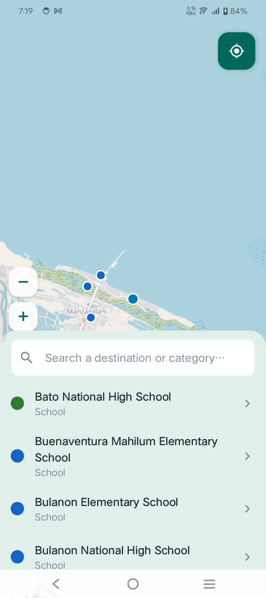
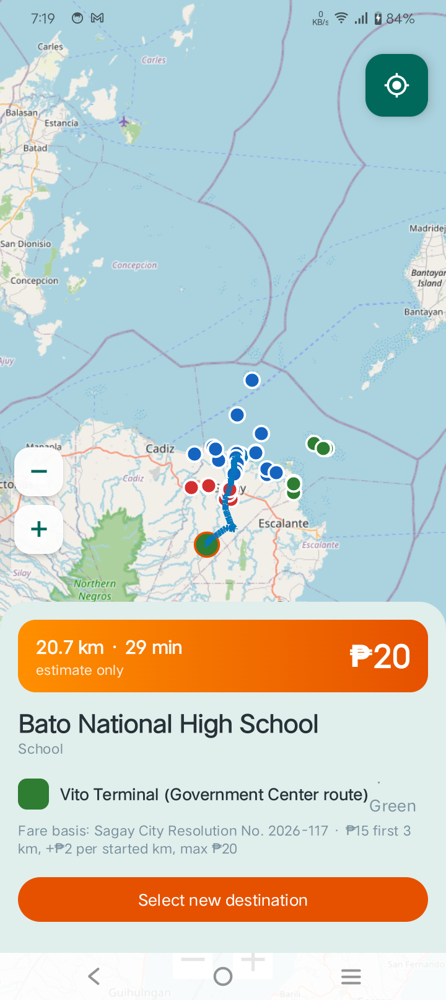
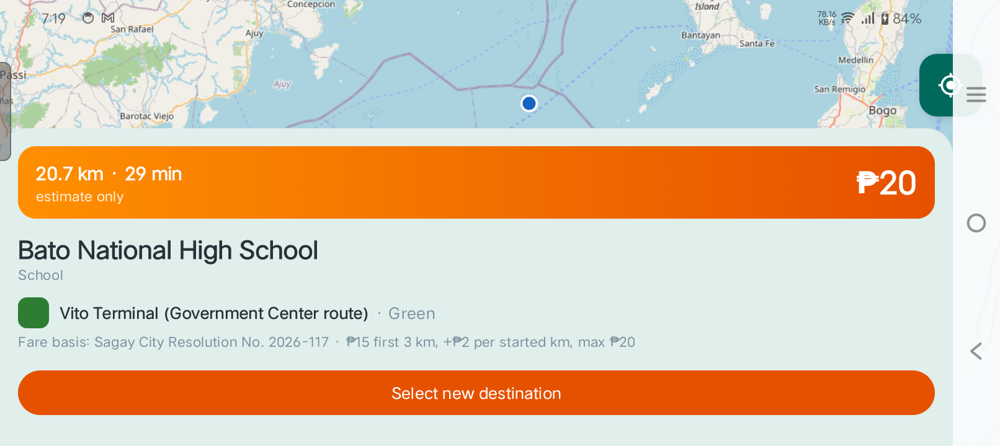

# Sagay Tourist Navigation — App Documentation

**Version:** 1.0.0 (versionCode 1) · **Package:** `com.sagay.touristnav`
**Platform:** Android 9+ (minSdk 28), targets Android 15 (targetSdk 35)
**Implementation:** native Kotlin + Jetpack Compose (`SagayTouristNavigation/`)

An offline-capable tourist navigator for **Sagay City, Negros Occidental,
Philippines**. It shows your GPS position on an OpenStreetMap map, lets you pick
a destination, and tells you the **road distance**, **travel time**, **estimated
fare**, and **which colour-coded terminal** serves that destination — including
which port to take a boat from for island/reef spots.

> This document describes the shipping **native Android** app. The repo also
> contains an earlier **Flutter** prototype (`lib/`), documented in the root
> [README](../README.md). For the v1.0.0 changelog see
> [RELEASE_NOTES](../SagayTouristNavigation/RELEASE_NOTES.md).

---

## 1. Screenshots

Captured on a physical Android device (v1.0.0 debug build):

| Destination search | Route & fare estimate |
| :---: | :---: |
|  |  |

Result preserved across rotation (landscape):



---

## 2. User guide

1. **Launch.** A branded "Sunrise Route" launch screen appears (tap to skip),
   then the app requests location permission.
2. **Grant location.** On first run, allow location access. The map centres on
   your GPS position. If permission is denied or GPS fails, a retry prompt is
   shown.
3. **Browse / search.** The bottom sheet lists all destinations with a coloured
   dot for their serving terminal. Type in the search box to filter by name or
   category (e.g. "School", "Beach").
4. **Select a destination.** The app fetches a road route and shows a result
   card: distance (km), duration (min), estimated fare (₱), the serving terminal
   and its colour, and the fare basis.
5. **Read the result.**
   - Island/reef destinations show a **boat note** ("Boat ride required from
     <terminal>") — the road leg ends at the port, not offshore.
   - A **distance warning** appears if the road distance looks implausible
     compared to straight-line (see §7).
6. **Navigate the map.** Use the **+ / −** zoom buttons (left edge) and the teal
   **Locate Me** button (top-right) to recenter on your position.
7. **Pick another.** "Select new destination" returns to the map/list.
8. **Rotate freely.** The current result survives orientation changes.
9. **Offline.** If there is no internet when you select a destination, the trip
   is saved and the app shows "waiting for internet"; it auto-resumes and fetches
   the route once connectivity returns.

---

## 3. Feature reference

- Searchable destination list: **38 destinations** (tourist spots + 21 DepEd
  schools) across **3 colour-coded terminals**; **8** island/reef entries flagged
  for boat routing.
- GPS positioning via Google fused location (single high-accuracy fix).
- OpenStreetMap rendering via **osmdroid** (no map API key).
- Road distance + duration + polyline via the public **OSRM** routing API.
- Stepped fare estimate with a **₱20 cap** (see §8).
- Straight-line (Haversine) sanity check on road distance.
- Offline persistence: bundled seed data + saved pending trips (Room/SQLite).
- Rotation-safe UI state; responsive Locate Me; map zoom controls.
- Branded adaptive launcher icon and calm-teal "Sunrise Route" theme.

**Out of scope by design:** booking, payments, real-time vehicle tracking, user
accounts, turn-by-turn voice navigation, boat-leg pricing.

---

## 4. Architecture

MVVM with a unidirectional `StateFlow<UiState>` and Hilt dependency injection.
Clean-ish layering: `ui → domain ← data`, with `platform` adapters and `di`
wiring.

```
ui/          Compose screens + TripViewModel + UiState + Theme
domain/      pure models + FareCalculator + Haversine + TripEstimator
data/local/  Room: AppDatabase, entities, DAOs, SeedLoader, SeedParser, mappers
data/remote/ DirectionsApi (Retrofit/OSRM) + DTOs
data/repo/   TripRepository (orchestrates routing, fare, persistence)
platform/    LocationProvider (fused GPS), ConnectivityObserver (network)
di/          AppModule, DatabaseModule, NetworkModule (Hilt)
```

| Component | Responsibility |
| --- | --- |
| `MainActivity` | Splash + edge-to-edge; shows `LaunchScreen` then `MapScreen`. |
| `SagayApp` | `Application`; Hilt entry, osmdroid user-agent, kicks off seeding. |
| `TripViewModel` | Owns the `UiState` machine, GPS, route fetch jobs, pending-trip resume. |
| `MapScreen` | osmdroid map, markers, route polyline, zoom + Locate Me, sheets/cards. |
| `TripRepository` | Reads seed data, calls OSRM, computes estimates, saves pending trips. |
| `TripEstimator` | Combines route + fare + Haversine warning + boat note into `TripEstimate`. |
| `FareCalculator` | Pure stepped-fare formula with cap. |
| `Haversine` | Great-circle distance + road-distance sanity check. |
| `SeedLoader` | Mutex-guarded, once-per-process upsert of bundled `seed.json`. |
| `AppDatabase` | Room v3; migration 2→3 preserves `trip_state`. |
| `LocationProvider` | One high-accuracy fused fix, `null` on any failure. |
| `ConnectivityObserver` | `callbackFlow` of validated-internet availability. |

---

## 5. UI state machine

`UiState` (sealed interface) drives every screen:

```
NeedsPermission ──grant──> Locating ──fix──> MapReady
      ▲                      │ null fix        │ select
      │ denied               ▼                 ▼
      └───────────────── GpsError        DestinationSelected
                           │ retry             │ fetch
                           └──> Locating       ▼
                                          FetchingRoute
                                          │        │
                              online err  │        │ offline (IOException)
                                          ▼        ▼
                                     RouteError  WaitingForInternet
                                          │ retry      │ connectivity returns
                                          └──> FetchingRoute <──┘
                                                   │ success
                                                   ▼
                                              ResultShown
                                                   │ select new
                                                   ▼
                                               MapReady
```

- `MapData` (position + destinations + terminal lookup) is shared by all
  post-permission states.
- Selecting a new destination **cancels** any in-flight fetch so stale results
  cannot overwrite the current selection.
- `WaitingForInternet` persists the trip as `PENDING_ROUTE` and auto-resumes.
- `RouteError` (online failure) is retryable via `retryRoute()`.

---

## 6. Data model & persistence

Room database `sagay_tourist_nav.db`, **version 3**.

| Entity | Table | Notes |
| --- | --- | --- |
| `TerminalEntity` | `terminal` | id, name, lat/lng, `colorHex`, `colorName`, `serviceArea`. |
| `DestinationEntity` | `destination` | id, name, category, lat/lng, `terminalId`, `requiresBoat`. |
| `FareRuleEntity` | `fare_rule` | id, `baseFare`, `baseKm`, `extraPerKm`, `source`, `maxFare` (nullable). |
| `TripStateEntity` | `trip_state` | origin lat/lng, `destinationId`, `status`, `savedAt`. |

`TripStateEntity.status`: `PENDING_ROUTE` (saved, awaiting connectivity) →
`DONE` (route fetched).

**Seeding.** `assets/seed.json` is the single source of bundled static data.
`SeedLoader.seed()` runs once per process under a mutex and **upserts**
(`OnConflictStrategy.REPLACE`) terminals, destinations, and the fare rule.
Editing `seed.json` therefore applies on the next app restart **without**
clearing app data, and never touches `trip_state`.

**Migrations.** `MIGRATION_2_3` adds `fare_rule.maxFare` via
`ALTER TABLE … ADD COLUMN`, preserving existing rows (including saved trips).
`fallbackToDestructiveMigration()` remains only as a last resort for unknown
future schema jumps.

### seed.json schema (abridged)

```json
{
  "note": "…verify locally…",
  "terminals": [
    { "id": "T1", "name": "…", "lat": 10.8968, "lng": 123.4168,
      "colorHex": "#D32F2F", "colorName": "Red", "serviceArea": "…" }
  ],
  "destinations": [
    { "id": "D1", "name": "Carbin Reef Sandbar", "category": "Beach / Island",
      "lat": 10.978, "lng": 123.4648, "terminalId": "T3", "boat": true }
  ],
  "fare_rule": { "id": 1, "baseFare": 15, "baseKm": 3, "extraPerKm": 2,
                 "source": "Sagay City Resolution No. 2026-117", "maxFare": 20 }
}
```

Every `destination.terminalId` must resolve to a `terminals[].id` (enforced by
`SeedParserTest`).

---

## 7. Routing & distance

- **Provider:** public OSRM, `https://router.project-osrm.org/`, driving profile:
  `GET route/v1/driving/{lng1,lat1;lng2,lat2}?overview=full&geometries=geojson`.
  Response DTOs follow the Mapbox Directions v5 schema (OSRM is its upstream).
- **Boat destinations:** the road leg targets the **serving port terminal's**
  coordinates, never the offshore point (a driving profile cannot cross water).
  The result adds a boat note; the boat leg itself is not priced.
- **Output:** `RouteSummary` = road km, duration minutes, and GeoJSON polyline
  points drawn on the map.
- **Sanity check (never used for fare):** `Haversine.isRoadDistanceSuspicious`
  flags a result when `roadKm < straightLineKm` or `roadKm > 3 × straightLineKm`
  (straight-line measured to the same road endpoint). Shown as a warning only.
- **Timeouts:** OkHttp connect/read timeouts are 15 s.

---

## 8. Fare calculation

`FareCalculator.compute(rule, roadKm)`:

```
raw = roadKm <= baseKm ? baseFare
                       : baseFare + ceil(roadKm - baseKm) * extraPerKm
fare = maxFare == null ? raw : clamp(raw, baseFare, maxFare)
```

Current rule: **₱15** for the first **3 km**, **+₱2 per started km** beyond
(`ceil`), **capped at ₱20** (Sagay City Resolution No. 2026-117 working rule).

| Road km | Raw | Charged |
| --- | --- | --- |
| 0–3 | 15 | ₱15 |
| 3.1 / 4 | 17 | ₱17 |
| 5 | 19 | ₱19 |
| 5.5 / 6 | 21 | **₱20** (cap) |
| 30.9 | 71 | **₱20** (cap) |

If the resolution's partial-km or ceiling wording differs, change only
`FareCalculator.compute` and update `FareCalculatorTest`.

---

## 9. Location, connectivity & offline behaviour

- **Location:** `LocationProvider.getCurrentLocation()` requests one
  `PRIORITY_HIGH_ACCURACY` fused fix; returns `null` on permission denial, GPS
  off, or timeout (callers show a retry prompt). Cancellation is propagated to
  the fused client.
- **Connectivity:** `ConnectivityObserver.isOnline` is a `callbackFlow` over
  `ConnectivityManager` that reports `NET_CAPABILITY_VALIDATED` internet,
  de-duplicated with `distinctUntilChanged`.
- **Offline select:** an `IOException` while offline saves/updates a
  `PENDING_ROUTE` trip and shows `WaitingForInternet`. When `isOnline` turns
  true, the ViewModel resumes the pending trip (guarded until data is loaded
  and the map is ready).
- **Online failure:** an `IOException` while online is a retryable `RouteError`
  (not treated as offline). `CancellationException` is always rethrown so
  superseded fetches never surface as errors.

---

## 10. Theming & branding

"Sunrise Route" design: calm **teal/neutral chrome** so the map and the
functional terminal colours (red/green/blue) stay the heroes; a warm **sunrise
accent** is reserved for the fare banner and primary actions. Light theme only
(dark mode intentionally not themed).

Key tokens (`SagayColors`): `TealPrimary #00695C`, `TealDark #004D40`,
`SunriseDeep #E65100`, `SunriseLight #FFB74D`, `MistSurface #F4FAF9`,
`RouteBlue/UserBlue #0277BD`, `WarningRed #C62828`.

- **Launch:** system splash (`installSplashScreen`) + branded `LaunchScreen`
  (tap to skip) before the permission flow.
- **Launcher icon:** adaptive icon — teal background + white route stroke and
  yellow pin foreground (`res/mipmap-anydpi-v26/`, `res/drawable/ic_launcher_*`).

---

## 11. Build & run

**Requirements:** JDK 17, Android SDK (minSdk 28 / targetSdk 35), Gradle wrapper
(included). Kotlin 2.0.21, AGP 8.7.3, KSP.

```bash
cd SagayTouristNavigation
./gradlew :app:testDebugUnitTest :app:assembleDebug
# APK: app/build/outputs/apk/debug/Sagay-Tourist-Navigator-debug.apk
```

Install on a connected device: `adb install -r app/build/outputs/apk/debug/Sagay-Tourist-Navigator-debug.apk`.
The APK base name is set via `base { archivesName = "Sagay-Tourist-Navigator" }`.
This is a **debug** build (not Play Store–signed).

---

## 12. Testing

JVM unit tests (`:app:testDebugUnitTest`):

| Test class | Covers |
| --- | --- |
| `FareCalculatorTest` | base/step boundaries, started-km `ceil`, large trips, and the ₱15–₱20 cap. |
| `HaversineTest` | known distances, zero distance, and the road-vs-straight-line warning rule. |
| `SeedParserTest` | 3 terminals / 38 destinations (21 schools), terminal-id resolution, 8 boat flags, fare values + cap, `#RRGGBB` colours. |

---

## 13. Configuration & replacing data

Edit **`SagayTouristNavigation/app/src/main/assets/seed.json`** only — no code
changes needed if you keep the schema. Then **restart the app**; the seed
refreshes automatically (no uninstall / clear-data required).

- Verify terminal colours/coordinates and school-to-terminal routing with the
  **Sagay City Tourism Office / LTFRB-franchised operators** before release.
- Replace `fare_rule` when the official city fare matrix is published.
- See the native [README](../SagayTouristNavigation/README.md) for the full
  data-replacement and calibration guide.

---

## 14. Dependencies (main)

| Library | Version | Use |
| --- | --- | --- |
| Kotlin / coroutines | 2.0.21 / 1.9.0 | language / async |
| Jetpack Compose (BOM) | 2024.12.01 | UI |
| Hilt | 2.52 | DI |
| Room | 2.6.1 | SQLite persistence |
| Retrofit / OkHttp | 2.11.0 / 4.12.0 | OSRM HTTP |
| kotlinx-serialization | 1.7.3 | JSON |
| osmdroid | 6.1.18 | OpenStreetMap map |
| play-services-location | 21.3.0 | fused GPS |
| core-splashscreen | 1.0.1 | launch splash |

Full pinned list: `SagayTouristNavigation/gradle/libs.versions.toml`.

---

## 15. Permissions & privacy

Declared: `ACCESS_FINE_LOCATION`, `ACCESS_COARSE_LOCATION`, `INTERNET`,
`ACCESS_NETWORK_STATE`. Location is used only on-device to centre the map and
compute routes; there is **no account, no backend, and no analytics**. The only
network calls are OSRM routing and OpenStreetMap tile fetches.

---

## 16. Known limitations

- All seed values are researched from public sources and are **placeholders
  pending local verification** (terminals, colours, coordinates, school routing).
- The fare is an **estimate**; the rule is a working rule pending the exact
  wording of Resolution No. 2026-117. Actual fares may vary.
- The public OSRM demo server is rate-limited and not for production; swap in a
  self-hosted OSRM / OpenRouteService before wide release.
- Island/reef results price only the road leg to the port; the boat ride is not
  priced and no boat schedule is provided.
- Offline mode saves the trip but cannot compute a road route until connectivity
  returns.
- Debug build only; not signed for store distribution.

---

## 17. Troubleshooting

| Symptom | Likely cause / fix |
| --- | --- |
| "Waiting for internet" | No validated connectivity; trip is saved and auto-resumes when online. |
| Route error with Retry | Online OSRM failure/timeout; tap Retry. |
| GPS / permission prompt | Location denied or GPS off; grant permission / enable GPS and retry. |
| Grey map grid | Tiles still loading or no connectivity; pan/zoom or reconnect. |
| Old data after editing seed.json | Restart the app (seed refreshes once per process). |
| Install failed (signature) | Uninstall the previous build first, then reinstall. |

---

## 18. Related documents

- Root [README](../README.md) — repo overview + screenshots + Flutter prototype.
- Native [README](../SagayTouristNavigation/README.md) — architecture & data guide.
- [RELEASE_NOTES](../SagayTouristNavigation/RELEASE_NOTES.md) — v1.0.0 changelog.
- Design specs: `docs/superpowers/specs/`.