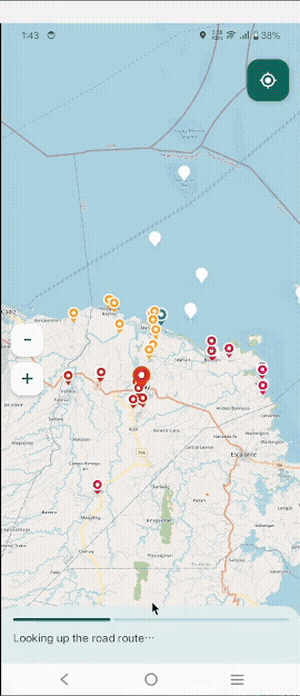

# Demo video — Sagay Tourist Navigator

A screen recording of the native Android app running on a physical device
(mirrored inside Android Studio's **Running Devices** panel), captured while
planning a trip from **Old Sagay** into **Sagay City**.

## Animated preview

This short preview shows the journey being looked up and the result card —
the **Yellow tricycle** leg, the change point at **Sagay City Bus Terminal
(Poblacion)**, the **Red tricycle** leg, the **₱20** corridor fare, and the
**₱16** discounted fare when the senior/student/PWD toggle is checked.

## Full recording

[Watch or download the full 2:55 recording (MP4, 7.6 MB)](sagay-tourist-navigator-demo.mp4)

| Property | Value |
| --- | --- |
| File | `sagay-tourist-navigator-demo.mp4` |
| Duration | 2 min 55 s |
| Resolution | 1280 × 720 |
| Frame rate | 30 fps |
| Codec | H.264 (yuv420p) + AAC |
| Size | 7.65 MB |

| Preview property | Value |
| --- | --- |
| File | `preview.gif` |
| Duration | 16 s |
| Size | 786 KB |
| Content | Cropped to the phone screen; the Yellow → Red journey and the discount toggle |

## What the recording shows

1. **Destination search** — the searchable sheet over the map, listing tourist
   spots and schools with their assigned tricycle colour.
2. **The Old Sagay to Sagay City journey** — a two-leg trip shown as
   **Yellow tricycle** to the change point, then **Red tricycle** for the final
   leg, with the change point named
   (*Sagay City Bus Terminal (Poblacion)*).
3. **The corridor fare** — one fare for the whole journey (**₱20**, or **₱16**
   with the 20% senior/student/PWD discount applied), taken from the official
   fare matrix of Resolution No. 2026-117 rather than a distance formula.
4. **The mapped route** — the OSRM road geometry between origin and
   destination.

## Encoding notes

The original capture was 125.6 MB, which is above GitHub's 100 MB limit for
files stored in a repository, so it was re-encoded with ffmpeg at CRF 20
(`-preset medium`, AAC 64 kbps, `+faststart`) to 7.65 MB at the same 1280 × 720
and 30 fps. The preview GIF was cropped to the phone screen from the most
relevant 16 seconds of the recording.

Source recording: `2026-11-18 13-42-27.mp4` (kept out of the repository
because of the 100 MB limit).

> **Why a GIF preview?** GitHub's README markdown turns an `.mp4` link into a
> plain `` tag and strips `<video>` HTML, so an MP4 cannot play inline in
> a README. The animated GIF renders natively on GitHub; the full MP4 is one
> click away above.

---

See the [app documentation](../APP_DOCUMENTATION.md) for the user guide,
architecture and fare rules, and the
[native app README](../../SagayTouristNavigation/README.md)
for the data replacement guide.
